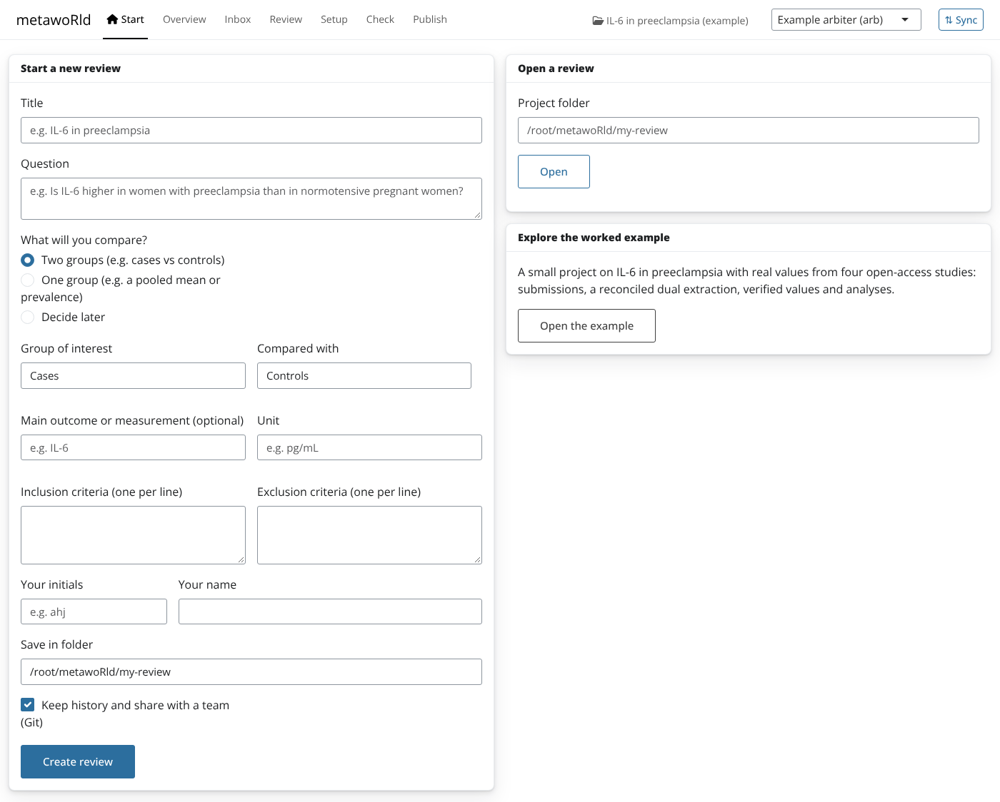
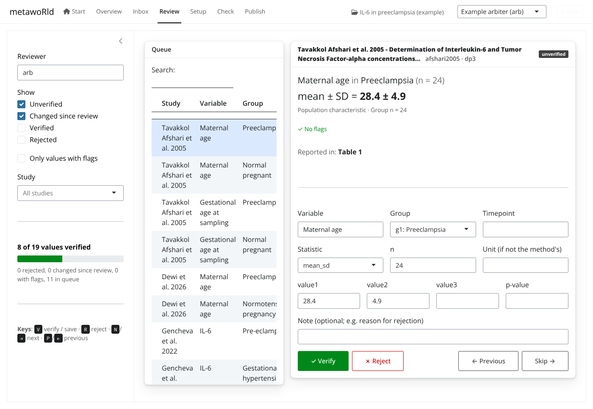
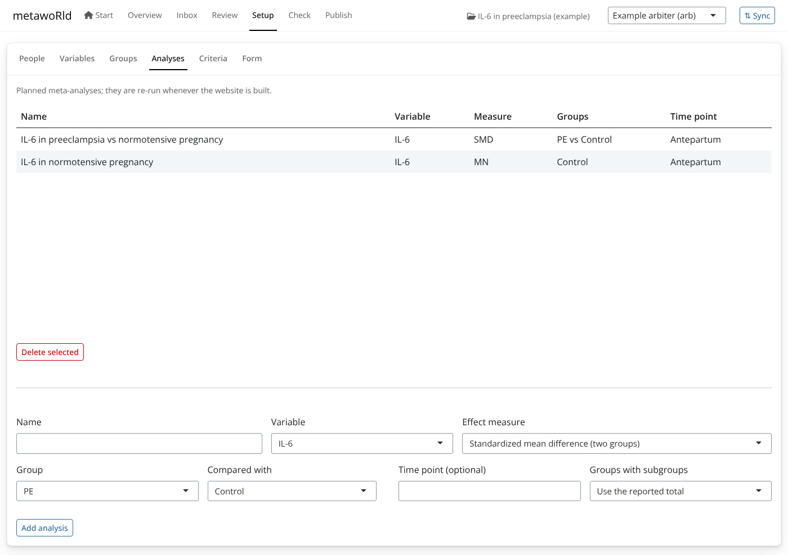

# The metawoRld app

``` r

metawoRld::launch()
```

opens the metawoRld app in your browser. It is a front door to the whole
review for people who do not want to write R. Everything it does is done
with the package’s functions, so the files it writes are the same, and
any step can also be done (and reproduced) from R.


Overview, inbox and rejecting a submission whose value differs from the
paper

## Start

Start a review with a short form: the title and question, what you
compare (two groups, one group, or decide later), the main outcome and
its unit, the criteria, and who you are. This calls
[`new_review()`](https://andjar.github.io/metawoRld/reference/new_review.md),
which sets up the group categories, the variable and a first
meta-analysis, so the first study can be added right away. You can also
open an existing project, or open the [worked
example](https://andjar.github.io/metawoRld/articles/worked-example.md)
to explore.



Starting a new review

## Overview

Progress at a glance (studies accepted, submissions waiting, values
verified, the project check) and a list of next steps, each linking to
the screen where it is done.

## Inbox

Submissions from every channel arrive here: the entry form, CSV files,
DataFindR, colleagues (through Sync). Each shows its groups, data points
and the checks from `_rules.yml`. Accept or reject (with a reason) in
one click.

When a submission is for a study that is already accepted, the Inbox
shows exactly what would change
([`compare_with_accepted()`](https://andjar.github.io/metawoRld/reference/compare_with_accepted.md)),
so a re-extraction cannot silently replace a correct value:


A re-extraction that would change one value

When two people extracted the same study, **Compare and reconcile**
lists the disagreements; pick the right value for each and the app calls
[`reconcile()`](https://andjar.github.io/metawoRld/reference/reconcile.md),
recording who agreed with every accepted value.

## Review

The value review app
([`review_values()`](https://andjar.github.io/metawoRld/reference/review_values.md))
as a tab: each value in plain language next to the paper, verified with
the keyboard.



Reviewing values

## Setup

The parts of a project people actually change, without editing YAML:
people and roles, variables (unit and other names), group categories
(including rules over group facts), planned analyses (pick a variable,
two groups and a measure), the criteria, and the form (shown as a
readable list; add a group fact such as onset with
[`add_group_fact()`](https://andjar.github.io/metawoRld/reference/add_group_fact.md)).



Planning an analysis

## Check and Publish

**Check** runs
[`check_project()`](https://andjar.github.io/metawoRld/reference/check_project.md)
and lists problems in plain language; **Publish** builds the living
meta-analysis website with Quarto and opens it.

## Working as a team: Sync

Projects can keep their history in Git, and the app hides the Git
commands:

- After each action (accept, reject, reconcile, a change in Setup) the
  app saves a commit with a readable message (“Accept gencheva2022 (…)
  by arb”), so the history reads like a log of the review.
- **Sync** saves your work, fetches the team’s work and sends yours
  ([`sync_project()`](https://andjar.github.io/metawoRld/reference/sync_project.md)).
  New submissions from colleagues then appear in the Inbox.
- Conflicts are rare by design: each extraction has its own folder in
  `submissions/`, only arbiters write `data/`, and `screening.csv`
  (which several people append to) is merged line by line.
- The app uses the system `git` command, so your existing sign-in (a
  credential manager, GitHub Desktop, SSH keys) works. To share a
  project, create an empty repository (e.g. on GitHub) and paste its
  address in the Sync dialog. Without write access, push to a fork and
  open a pull request.
