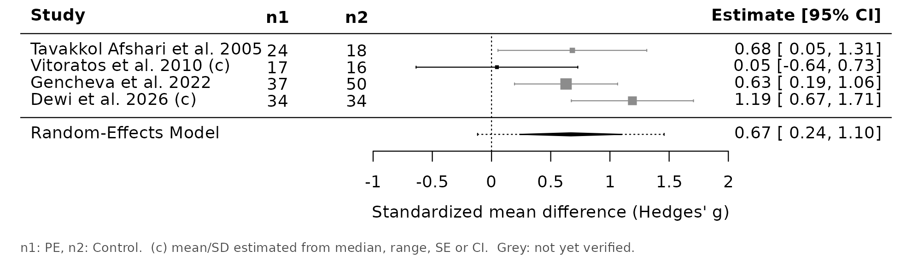
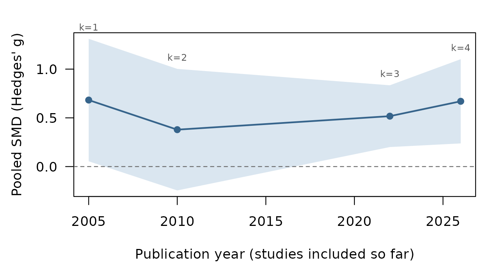
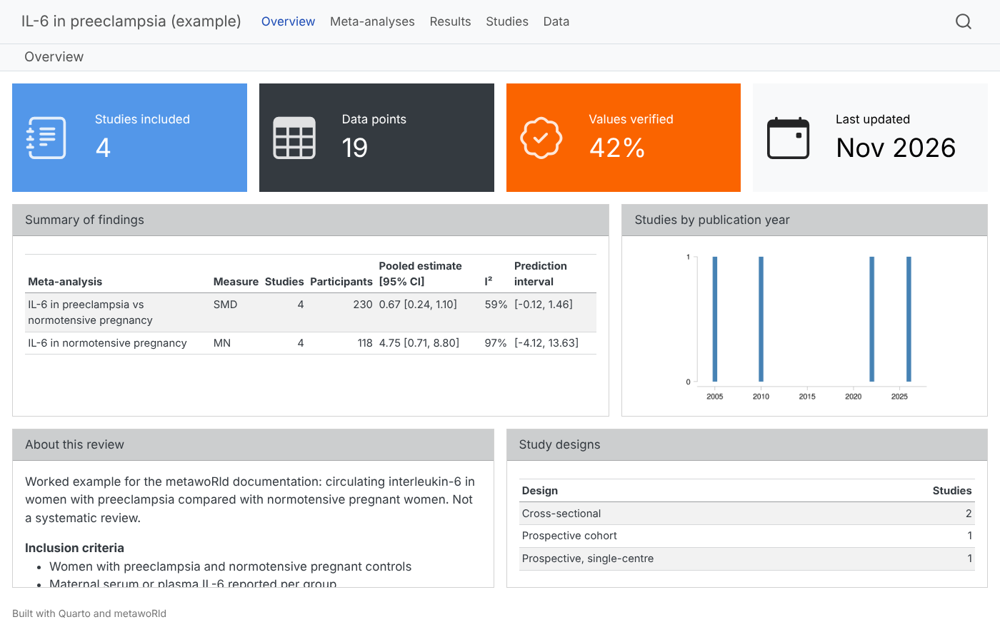

# Worked example: IL-6 in preeclampsia

This article walks through a whole metawoRld project on a small, real
question: **is circulating interleukin-6 (IL-6) higher in women with
preeclampsia than in normotensive pregnant women?** The data come from
four open-access studies. They report IL-6 in four different ways, which
is exactly what makes data extraction hard:

| Study | Country | Sample | IL-6 reported as |
|----|----|----|----|
| Tavakkol Afshari et al. 2005, *BMC Pregnancy Childbirth* | Iran | serum, ELISA | mean (SD) |
| Vitoratos et al. 2010, *Mediators Inflamm* | Greece | plasma, ELISA | mean ± SE, at diagnosis and 12–14 weeks postpartum |
| Gencheva et al. 2022, *Cardiovasc J Afr* | Bulgaria | serum, ELISA | mean ± SD; also a gestational-hypertension group and early/late-onset subgroups |
| Dewi et al. 2026, *Narra J* | Indonesia | serum, ECLIA | median (min–max) |

This is a documentation example, not a systematic review: the studies
were chosen to show the package, not found by a systematic search. The
values were transcribed from the articles and each carries its location
in the paper; the people are example personas. The data files are in
`system.file("extdata", "il6-preeclampsia", package = "metawoRld")`, and
[`example_project()`](https://andjar.github.io/metawoRld/reference/example_project.md)
builds the same project in one call.

``` r

library(metawoRld)
src <- system.file("extdata", "il6-preeclampsia", package = "metawoRld")
extraction <- function(file) yaml::read_yaml(file.path(src, "extractions", paste0(file, ".yml")))
```

## 1. Set up the project

``` r

path <- file.path(tempdir(), "il6-preeclampsia")
create_metawoRld(
  path,
  project_name = "IL-6 in preeclampsia (example)",
  project_description = "Circulating interleukin-6 in preeclampsia vs normotensive pregnancy.",
  inclusion_criteria = c("Women with preeclampsia and normotensive pregnant controls",
                         "Maternal serum or plasma IL-6 reported per group"),
  exclusion_criteria = c("Other hypertensive disorders only (e.g. HELLP syndrome)",
                         "Group sizes or IL-6 values not reported"),
  git_init = FALSE
)
#> Created metawoRld project at /tmp/RtmpPwPINK/il6-preeclampsia
```

Everyone who screens, extracts or verifies is registered once. Every
decision and every value is later traced back to one of these ids.

``` r

add_person(path, "ext1", "Example extractor 1", roles = c("screener", "extractor", "verifier"))
add_person(path, "ext2", "Example extractor 2", roles = c("screener", "extractor", "verifier"))
add_person(path, "arb", "Example arbiter", roles = c("admin", "arbiter", "verifier"))
```

What is extracted is defined by `forms/extraction.yml` (generic by
default). The vocabulary in `_rules.yml` maps the names used in papers
to canonical names and groups to categories; `_analyses.yml` lists the
planned meta-analyses.

``` r

rules <- read_rules(path)
rules$variables <- list(
  `IL-6` = list(synonyms = list("Interleukin-6", "IL6"), unit = "pg/mL"),
  `Maternal age` = list(unit = "years"),
  `Gestational age at sampling` = list(unit = "weeks")
)
rules$group_categories <- list(
  PE = list(synonyms = list("Preeclampsia", "Pre-eclampsia")),
  Control = list(synonyms = list("Normal pregnant", "Normotensive controls",
                                 "Healthy pregnant controls", "Normotensive pregnancy")),
  GH = list(synonyms = list("Gestational hypertension"))
)
metawoRld:::.write_rules(file.path(path, "_rules.yml"), rules)

writeLines(c(
  "analyses:",
  "  - name: IL-6 in preeclampsia vs normotensive pregnancy",
  "    variable: IL-6",
  "    measure: SMD",
  "    compare: [PE, Control]",
  "    timepoint: Antepartum"
), file.path(path, "_analyses.yml"))
```

## 2. Search log and screening

Searches and records are logged in the project, so the PRISMA counts can
be computed from the files alone.

``` r

add_search(path, "example-2026-11", "PubMed and journal websites",
           "interleukin-6 AND (preeclampsia OR pre-eclampsia), open-access full texts",
           results = 6, person = "arb", date = as.Date("2026-11-13"))
records <- read.csv(file.path(src, "records.csv"), colClasses = "character")
rid <- add_records(path, records, search = "example-2026-11")$record_id
read_records(path)[, c("record_id", "year", "journal")]
#> # A tibble: 6 × 3
#>   record_id                   year  journal                                    
#>   <chr>                       <chr> <chr>                                      
#> 1 10.1186/1471-2393-5-14      2005  BMC Pregnancy and Childbirth               
#> 2 10.1155/2010/908649         2010  Mediators of Inflammation                  
#> 3 rec-8cc42da542f2            2022  Cardiovascular Journal of Africa           
#> 4 10.52225/narra.v6i1.3016    2026  Narra J                                    
#> 5 10.30659/sainsmed.v9i2.3630 2018  Sains Medika                               
#> 6 rec-007cefffa04d            2021  Journal of the Pakistan Medical Association
```

Two people screen titles and abstracts independently. They disagree on
the HELLP-syndrome study, so
[`screening_status()`](https://andjar.github.io/metawoRld/reference/add_screening.md)
reports a conflict until the arbiter records a consensus decision.

``` r

add_screening(path, rid, "title_abstract",
              c("include", "include", "include", "include", "exclude", "include"),
              c("", "", "", "", "HELLP syndrome, not preeclampsia", ""), person = "ext1")
add_screening(path, rid, "title_abstract", rep("include", 6), person = "ext2")
screening_status(path)[, c("record_id", "outcome", "n_decisions")]
#> # A tibble: 6 × 3
#>   record_id                   outcome  n_decisions
#>   <chr>                       <chr>          <int>
#> 1 10.1155/2010/908649         include            2
#> 2 10.1186/1471-2393-5-14      include            2
#> 3 10.30659/sainsmed.v9i2.3630 conflict           2
#> 4 10.52225/narra.v6i1.3016    include            2
#> 5 rec-007cefffa04d            include            2
#> 6 rec-8cc42da542f2            include            2

add_screening(path, rid[5], "title_abstract", "exclude", "HELLP syndrome, not preeclampsia",
              person = "arb", kind = "consensus")
add_screening(path, rid[-5], "full_text", c("include", "include", "include", "include", "exclude"),
              c("", "", "", "", "Group sizes not reported"), person = "arb")
```

## 3. Submit through the one door

Every channel (the entry form, a CSV file, DataFindR, a script) hands
its extraction to
[`submit_study()`](https://andjar.github.io/metawoRld/reference/submit_study.md).
It is checked against the form and staged in `submissions/`; nothing
reaches `data/` yet.

``` r

e <- extraction("afshari2005")
e$data_points[[1]][c("variable_name", "group_id", "statistic_type", "value1", "value2", "source")]
#> $variable_name
#> [1] "IL-6"
#> 
#> $group_id
#> [1] "g1"
#> 
#> $statistic_type
#> [1] "mean_sd"
#> 
#> $value1
#> [1] 5.8
#> 
#> $value2
#> [1] 4.85
#> 
#> $source
#> [1] "Abstract (p. 1); Results (p. 2-3)"
id <- submit_study(path, "afshari2005", e$metadata, e$data_points, person = "ext1",
                   channel = "entry_form")
#> Submitted afshari2005 (20261113T095419-ext1-extraction): 6 data point(s).
```

Invalid data are refused with every problem listed, and nothing is
written:

``` r

bad <- e
bad$data_points[[1]]$group_id <- "g3"          # a group the study does not have
bad$data_points[[2]]$statistic_type <- "mean (SD)"
submit_study(path, "afshari2005", bad$metadata, bad$data_points, person = "ext1")
#> Error in `.abort_validation()`:
#> ! Validation failed for study 'afshari2005' (2 problem(s)):
#> ✖ data_points[2].statistic_type: 'mean (SD)' is not one of [mean_sd, mean_se, mean_ci95, median_iqr, median_range, n_percent, count, proportion, geometric_mean_sd, other].
#> ✖ data_points.group_id: value(s) 'g3' not defined in metadata.groups[].group_id (defined: g1, g2)
```

A person accepts the submission. The values move to `data/afshari2005/`
with a record of where each one came from:

``` r

accept_submission(path, "afshari2005", id, person = "arb")
#> Accepted 20261113T095419-ext1-extraction into data/afshari2005.
read_study(path, "afshari2005")$provenance[, c("measurement_id", "person", "channel", "timestamp")]
#> # A tibble: 7 × 4
#>   measurement_id person channel    timestamp           
#>   <chr>          <chr>  <chr>      <chr>               
#> 1 _metadata      ext1   entry_form 2026-11-13T09:54:19Z
#> 2 dp1            ext1   entry_form 2026-11-13T09:54:19Z
#> 3 dp2            ext1   entry_form 2026-11-13T09:54:19Z
#> 4 dp3            ext1   entry_form 2026-11-13T09:54:19Z
#> 5 dp4            ext1   entry_form 2026-11-13T09:54:19Z
#> 6 dp5            ext1   entry_form 2026-11-13T09:54:19Z
#> 7 dp6            ext1   entry_form 2026-11-13T09:54:19Z

for (s in c("gencheva2022", "dewi2026")) {
  e <- extraction(s)
  id <- submit_study(path, s, e$metadata, e$data_points, person = "ext1", channel = "entry_form")
  accept_submission(path, s, id, person = "arb")
}
#> Submitted gencheva2022 (20261113T095419-ext1-extraction): 5 data point(s).
#> Accepted 20261113T095419-ext1-extraction into data/gencheva2022.
#> Submitted dewi2026 (20261113T095419-ext1-extraction): 4 data point(s).
#> Accepted 20261113T095419-ext1-extraction into data/dewi2026.
link_record(path, rid[3], "gencheva2022")   # this report has no DOI/PMID to match on
```

## 4. Dual extraction finds a real reporting problem

Two people extracted Vitoratos et al. (2010) independently. The paper is
inconsistent: Table 2 and the Methods give IL-6 as mean ± SE, but the
Results text calls the postpartum values mean ± SD. Extractor 1 followed
the table, extractor 2 the text.
[`compare_extractions()`](https://andjar.github.io/metawoRld/reference/compare_extractions.md)
lines up the data points by variable, group, method, time point and
statistic, so the antepartum values agree and the postpartum values do
not:

``` r

e1 <- extraction("vitoratos2010-ext1")
e2 <- extraction("vitoratos2010-ext2")
s1 <- submit_study(path, "vitoratos2010", e1$metadata, e1$data_points, person = "ext1",
                   channel = "entry_form")
#> Submitted vitoratos2010 (20261113T095420-ext1-extraction): 4 data point(s).
s2 <- submit_study(path, "vitoratos2010", e2$metadata, e2$data_points, person = "ext2",
                   channel = "csv_import")
#> Submitted vitoratos2010 (20261113T095420-ext2-extraction): 4 data point(s).
cmp <- compare_extractions(path, "vitoratos2010", c(s1, s2))
names(cmp)[4:5] <- c("ext1", "ext2")
table(agree = cmp$agree, part = cmp$part)
#>        part
#> agree   data metadata
#>   FALSE   16        1
#>   TRUE     8       20
```

The disagreements, one line per data point (the values of each data
point follow in further rows of `cmp`):

``` r

d <- cmp[!cmp$agree & cmp$field %in% c("(row)", "notes"), c("part", "key", "field", "ext1", "ext2")]
d$ext1 <- ifelse(nchar(d$ext1) > 40, paste0(substr(d$ext1, 1, 37), "..."), d$ext1)
knitr::kable(d, row.names = FALSE)
```

| part | key | field | ext1 | ext2 |
|:---|:---|:---|:---|:---|
| metadata | notes | notes | Table 2 and the Methods give IL-6 as … | NA |
| data | IL-6 \| g1 \| m1 \| 12-14 weeks postpartum \| mean_se | (row) | present | NA |
| data | IL-6 \| g2 \| m1 \| 12-14 weeks postpartum \| mean_se | (row) | present | NA |
| data | IL-6 \| g1 \| m1 \| 12-14 weeks postpartum \| mean_sd | (row) | NA | present |
| data | IL-6 \| g2 \| m1 \| 12-14 weeks postpartum \| mean_sd | (row) | NA | present |

The arbiter checks the paper and keeps the table’s mean ± SE (it agrees
with the Methods).
[`reconcile()`](https://andjar.github.io/metawoRld/reference/reconcile.md)
records the decision:

``` r

dis <- cmp[!cmp$agree, ]
rows <- unique(dis$key[dis$part == "data"])
choices <- data.frame(
  part  = c("metadata", rep("data", length(rows))),
  key   = c("notes", rows),
  field = c("notes", rep("(row)", length(rows))),
  from  = c(s1, ifelse(grepl("mean_se", rows), s1, NA)),
  value = c(NA, ifelse(grepl("mean_se", rows), NA, "drop"))
)
reconcile(path, "vitoratos2010", c(s1, s2), choices = choices, person = "arb")
#> Reconciled 2 extractions into data/vitoratos2010 (17 disagreement(s), 5 choice(s)).
```

`provenance.csv` now shows, for every value, which extraction it came
from and which other extraction agreed with it: both extractors agreed
on the antepartum values, only extractor 1 on the postpartum ones.

``` r

pr <- read_study(path, "vitoratos2010")$provenance
pr$agreed <- nzchar(pr$agreed_with)
pr[, c("measurement_id", "person", "channel", "agreed")]
#> # A tibble: 5 × 4
#>   measurement_id person channel    agreed
#>   <chr>          <chr>  <chr>      <lgl> 
#> 1 _metadata      ext1   entry_form FALSE 
#> 2 dp1            ext1   entry_form TRUE  
#> 3 dp2            ext1   entry_form TRUE  
#> 4 dp3            ext1   entry_form FALSE 
#> 5 dp4            ext1   entry_form FALSE
```

## 5. Refine groups during the review

Halfway through, onset of preeclampsia turns out to matter. Gencheva et
al. report IL-6 for all women with preeclampsia **and** for the early-
and late-onset subgroups, so the same women appear twice. Both levels
are kept: the subgroups are linked to their total with
`parent_group_id`, and onset becomes a fact of groups in the form.
Subgroups inherit the facts of their parent, so the early-onset group is
also preeclampsia.

``` r

add_group_fact(path, "onset", c("early", "late", "not reported"),
               "Onset of preeclampsia as defined by the study (early or late onset).")
rules <- read_rules(path)
rules$group_categories$PE_early <- list(where = list(category = "PE", onset = "early"))
rules$group_categories$PE_late <- list(where = list(category = "PE", onset = "late"))
metawoRld:::.write_rules(file.path(path, "_rules.yml"), rules)
```

Studies accepted before the change are still valid.
[`refinement_queue()`](https://andjar.github.io/metawoRld/reference/refinement_queue.md)
lists the preeclampsia groups where onset has not been assessed:

``` r

refinement_queue(path, "onset", category = "PE")
#> # A tibble: 4 × 4
#>   study_id      group_id name          parent_group_id
#>   <chr>         <chr>    <chr>         <chr>          
#> 1 afshari2005   g1       Preeclampsia  NA             
#> 2 dewi2026      g1       Preeclampsia  NA             
#> 3 gencheva2022  pe       Pre-eclampsia NA             
#> 4 vitoratos2010 g1       Preeclampsia  NA
```

Refinements go through the same door as extractions: an amendment that
an arbiter accepts. Provenance and verification of everything that did
not change are kept.

``` r

am <- amend_study(path, "gencheva2022", person = "ext1", note = "Onset subgroups linked to the PE total.",
                  groups = list(list(group_id = "pe_early", parent_group_id = "pe", onset = "early"),
                                list(group_id = "pe_late", parent_group_id = "pe", onset = "late")))
#> Submitted gencheva2022 (20261113T095420-ext1-extraction): 5 data point(s).
accept_submission(path, "gencheva2022", am, person = "arb")
#> Accepted 20261113T095420-ext1-extraction into data/gencheva2022.
group_memberships(read_study(path, "gencheva2022")$metadata$groups, read_rules(path))
#> # A tibble: 7 × 2
#>   group_id category
#>   <chr>    <chr>   
#> 1 pe       PE      
#> 2 pe_early PE      
#> 3 pe_late  PE      
#> 4 ctrl     Control 
#> 5 gh       GH      
#> 6 pe_early PE_early
#> 7 pe_late  PE_late
```

The early-onset group belongs to both PE and PE_early. The subgroups are
also checked against their total: 31 + 6 = 37 women, and pooling the
subgroups’ means and SDs gives 8.06 (SD 12.48), exactly the reported
total, so
[`check_values()`](https://andjar.github.io/metawoRld/reference/check_values.md)
raises nothing.

``` r

check_values(path, "gencheva2022")
#> # A tibble: 0 × 5
#> # ℹ 5 variables: study_id <chr>, measurement_id <chr>, check <chr>, severity <chr>, message <chr>
```

## 6. Verify values against the papers

[`review_values()`](https://andjar.github.io/metawoRld/reference/review_values.md)
opens a Shiny app that shows each value in plain language, with its
flags and source, next to the full text at the right page. `V` verifies,
`R` rejects, `N`/`P` move through the queue. A verification is tied to a
hash of the values, so a value that changes later returns to the queue.


The same decisions can be recorded from R:

``` r

set_verification(path, "vitoratos2010", c("dp1", "dp2", "dp3", "dp4"), reviewer = "arb",
                 note = "Checked against Table 2 (mean +/- SE).")
table(verification_status(path)$status)
#> 
#> unverified   verified 
#>         15          4
```

## 7. Check the project

[`check_project()`](https://andjar.github.io/metawoRld/reference/check_project.md)
checks forms, schemas, links, provenance, people, records and screening,
and recomputes the file hashes in each study’s `datapackage.json`. It is
the command to run in continuous integration
([`use_github_action_check()`](https://andjar.github.io/metawoRld/reference/use_github_action_check.md)).

``` r

check_project(path)
#> check_project(): 4 study(ies), 0 error(s), 0 warning(s).
prisma_counts(path)
#> # A tibble: 10 × 2
#>    stage                                      n
#>    <chr>                                  <int>
#>  1 "Records identified"                       6
#>  2 "Duplicates removed"                       0
#>  3 "Records screened (title/abstract)"        6
#>  4 "Records excluded (title/abstract)"        1
#>  5 "Awaiting decision (title/abstract)"       0
#>  6 "Reports assessed (full text)"             5
#>  7 "Reports excluded (full text)"             1
#>  8 "  Excluded: Group sizes not reported"     1
#>  9 "Studies included"                         4
#> 10 "Reports of included studies"              4
```

A value edited by hand, outside metawoRld, is caught:

``` r

f <- file.path(path, "data", "dewi2026", "data.csv")
x <- readLines(f); x[2] <- sub("16.05", "61.05", x[2], fixed = TRUE); writeLines(x, f)
check_project(path)$message
#> x data/dewi2026: data.csv changed outside metawoRld (hash differs from datapackage.json).
#> check_project(): 4 study(ies), 1 error(s), 0 warning(s).
#> [1] "data.csv changed outside metawoRld (hash differs from datapackage.json)."
```

## 8. Living meta-analysis

Medians with ranges and SEs are converted to means and SDs (Wan et al.
2014), group names are mapped to the categories in `_rules.yml`, and
only antepartum values are used, as `_analyses.yml` asks.

``` r

ma <- run_meta_analysis(path, read_analyses(path)[[1]])
ma$summary[, c("studies", "participants", "estimate", "I2", "prediction_interval")]
#> # A tibble: 1 × 5
#>   studies participants estimate          I2    prediction_interval
#>     <int>        <dbl> <chr>             <chr> <chr>              
#> 1       4          230 0.67 [0.24, 1.10] 59%   [-0.12, 1.46]
```

``` r

plot_forest(ma)
```



The cumulative meta-analysis shows how the pooled estimate evolved as
studies were published, the essence of a living review:

``` r

plot_cumulative(ma)
```



With four small, heterogeneous studies, the estimate is uncertain (the
prediction interval includes zero), as it should be for an example this
size.

### Apples to apples: one level per study

Every analysis states the level it compares, and each study contributes
exactly one set of participants per arm. `selection` (also shown on the
dashboard) records which groups each study contributed and how:

``` r

ma$selection[, c("study_id", "arm", "group_names", "how", "n")]
#> # A tibble: 8 × 5
#>   study_id      arm     group_names               how          n
#>   <chr>         <chr>   <chr>                     <chr>    <dbl>
#> 1 afshari2005   PE      Preeclampsia              reported    24
#> 2 afshari2005   Control Normal pregnant           reported    18
#> 3 dewi2026      PE      Preeclampsia              reported    34
#> 4 dewi2026      Control Normotensive pregnancy    reported    34
#> 5 gencheva2022  PE      Pre-eclampsia             reported    37
#> 6 gencheva2022  Control Healthy pregnant controls reported    50
#> 7 vitoratos2010 PE      Preeclampsia              reported    17
#> 8 vitoratos2010 Control Normotensive controls     reported    16
```

Gencheva contributes its reported preeclampsia total (n = 37), not the
total plus its subgroups. As a sensitivity analysis, `levels: pool` uses
the subgroups pooled instead; here that gives the same numbers, because
they reproduce the total:

``` r

a <- read_analyses(path)[[1]]
pooled <- run_meta_analysis(path, modifyList(a, list(name = "Subgroups pooled", levels = "pool")))
pooled$selection[pooled$selection$study_id == "gencheva2022", c("arm", "how", "n")]
#> # A tibble: 2 × 3
#>   arm     how                                       n
#>   <chr>   <chr>                                 <dbl>
#> 1 PE      pooled subgroups (pe_early + pe_late)    37
#> 2 Control reported                                 50
pooled$summary$estimate == ma$summary$estimate
#> [1] TRUE
```

A subgroup analysis compares the subgroups instead. Each study
contributes one row per subgroup it reports; the 50 controls shared by
Gencheva’s two subgroups are split 25/25, so no control is counted
twice. Only one study reports onset here, so this only illustrates the
mechanics:

``` r

by_onset <- run_meta_analysis(path, modifyList(a, list(name = "IL-6 by onset", subgroups = c("PE_early", "PE_late"))))
by_onset$data[, c("label", "n1", "n2", "note")]
#> # A tibble: 2 × 4
#>   label                              n1    n2 note                                                  
#>   <chr>                           <dbl> <dbl> <chr>                                                 
#> 1 Gencheva et al. 2022 [PE_early]    31    25 Control group shared by 2 subgroups: its n is split 2…
#> 2 Gencheva et al. 2022 [PE_late]      6    25 Control group shared by 2 subgroups: its n is split 2…
by_onset$excluded
#> # A tibble: 3 × 2
#>   study_id      reason                               
#>   <chr>         <chr>                                
#> 1 afshari2005   no usable data for: PE_early, PE_late
#> 2 dewi2026      no usable data for: PE_early, PE_late
#> 3 vitoratos2010 no usable data for: PE_early, PE_late
```

## 9. The dashboard

[`generate_website()`](https://andjar.github.io/metawoRld/reference/generate_website.md)
builds a Quarto dashboard that is rebuilt on every change
([`use_github_action_quarto()`](https://andjar.github.io/metawoRld/reference/use_github_action_quarto.md)
publishes it on GitHub Pages):



Overview page


One page per meta-analysis

## In one call

``` r

p <- example_project(file.path(tempdir(), "il6"))
review_values(p)
generate_website(p)
```

## Sources

- Tavakkol Afshari J, Ghomian N, Shameli A, et al. Determination of
  interleukin-6 and tumor necrosis factor-alpha concentrations in
  Iranian-Khorasanian patients with preeclampsia. *BMC Pregnancy
  Childbirth* 2005;5:14. <https://doi.org/10.1186/1471-2393-5-14>
- Vitoratos N, Economou E, Iavazzo C, et al. Maternal serum levels of
  TNF-alpha and IL-6 long after delivery in preeclamptic and
  normotensive pregnant women. *Mediators Inflamm* 2010;2010:908649.
  <https://doi.org/10.1155/2010/908649>
- Gencheva D, Nikolov F, Uchikova E, et al. Interleukin-6 and its
  correlations with maternal characteristics and echocardiographic
  parameters in pre-eclampsia, gestational hypertension and normotensive
  pregnancy. *Cardiovasc J Afr* 2022;33(2):65–73.
  <https://pmc.ncbi.nlm.nih.gov/articles/PMC9364472>
- Dewi SR, Yeni CM, Munizar M, et al. Comparison of interleukin-6 and
  serum creatinine levels in preeclampsia and normal pregnancy patients:
  a cross-sectional study in Indonesia. *Narra J* 2026;6(1):e3016.
  <https://doi.org/10.52225/narra.v6i1.3016>
- Wan X, Wang W, Liu J, Tong T. Estimating the sample mean and standard
  deviation from the sample size, median, range and/or interquartile
  range. *BMC Med Res Methodol* 2014;14:135.
  <https://doi.org/10.1186/1471-2288-14-135>
